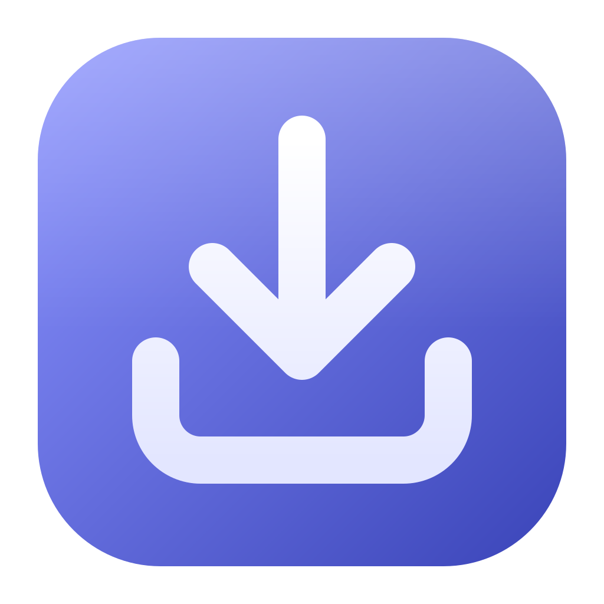
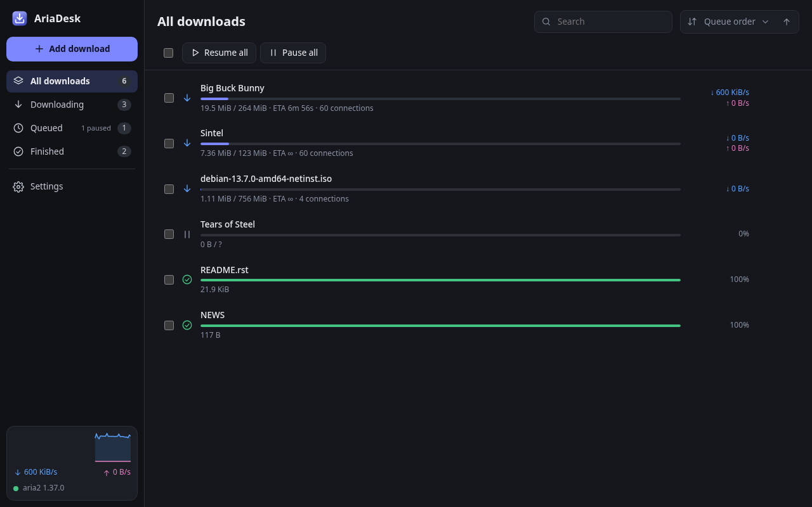
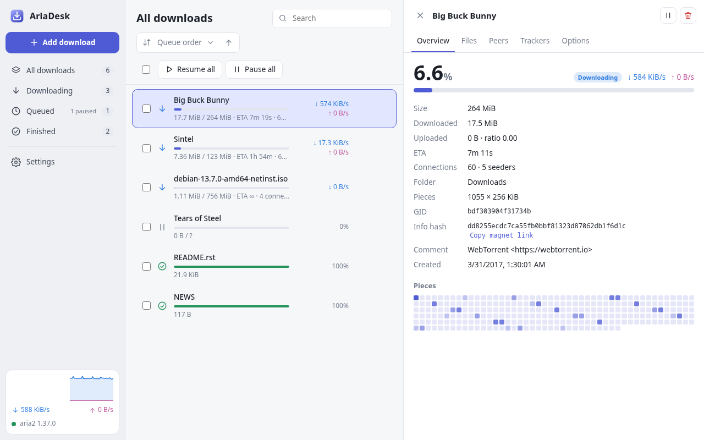
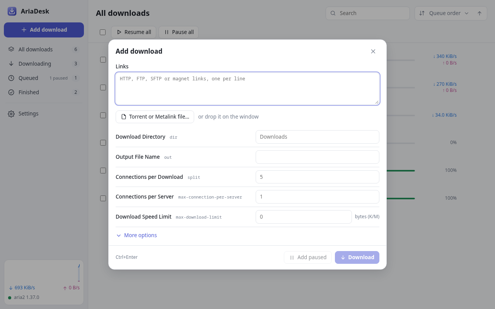

<p align="center">
  
</p>

<h1 align="center">AriaDesk</h1>

<p align="center">
  <a href="https://github.com/Matzull/AriaDesk/actions/workflows/ci.yml"></a>
  <a href="https://github.com/Matzull/AriaDesk/actions/workflows/release.yml"></a>
  <a href="https://github.com/Matzull/AriaDesk/releases/latest"></a>
  <a href="https://github.com/Matzull/AriaDesk/releases"></a>
  
  <a href="LICENSE"></a>
</p>

A desktop frontend for [aria2](https://aria2.github.io/) for **Windows, macOS and Linux**, built with [Tauri 2](https://tauri.app/), plus a static **web** build.



<table>
  <tr>
    <td></td>
    <td></td>
  </tr>
</table>

## Download

Installers for every platform are on the [releases page](https://github.com/Matzull/AriaDesk/releases/latest):

| Platform | Files |
|---|---|
| Linux (x64, arm64) | `.deb`, `.rpm`, `.AppImage` |
| Windows (x64) | `.msi`, setup `.exe` |
| macOS (Apple silicon and Intel) | universal `.dmg` |
| Web | `.zip` of static files |

AriaDesk needs [aria2](https://aria2.github.io/) installed; if it is not running, AriaDesk offers to start it. Unsigned macOS builds have to be opened the first time with right click → Open.

## About

AriaDesk talks to aria2 over its JSON-RPC interface. The interface is written with [Svelte 5](https://svelte.dev/) and built with Vite; on the desktop a Rust backend makes the RPC requests (so CORS does not apply) and provides the system integration. Torrent parsing lives in a shared Rust crate that runs natively on the desktop and as WebAssembly in the browser.

## Features

- Download list with filters (downloading, queued, finished), search, sorting and bulk actions (pause, resume, retry, remove, queue order)
- Detail panel per download: overview with piece map, files (change the selection of torrent files), peers, trackers or sources, and per-task options
- New download dialog for HTTP/FTP/SFTP/magnet links and `.torrent` / `.metalink` files, with a preview of the torrent contents to choose which files to download
- Every aria2 global option, grouped and searchable, with descriptions
- aria2 RPC over HTTP(S) or WebSocket, with secret token
- Light and dark themes, English and Spanish
- Desktop:
  - Tray icon (Windows/Linux), close to tray, native notifications when downloads finish
  - Default magnet link handler, `.torrent` / `.metalink` file associations
  - Single instance: files and links opened later go to the running window
  - If aria2 is not running on this machine, offers to start it in the background (or does it always, if chosen); it stops when AriaDesk quits and unfinished downloads resume on the next start
  - Run a command at startup (for example `aria2c`), drag and drop of files and links
  - Window size and position are remembered
- Web build: static files you can serve from any HTTP server

## Layout

| Path | Contents |
|---|---|
| `ui/` | Frontend (Svelte 5): `src/lib` holds the RPC client, state and platform layer, `src/components` the views |
| `ui/src/lib/native.js` | Platform layer: Tauri backend on the desktop, browser APIs on the web |
| `ui/public/wasm/` | Generated wasm bindings of `ariadesk-core` |
| `crates/ariadesk-core/` | Shared Rust logic (bencode, torrent info) |
| `src-tauri/` | Tauri backend (IPC channels, tray, menus, WebSocket, HTTP, startup command) |
| `scripts/` | wasm build script |
| `packaging/linux/` | Desktop entry and AppStream metainfo for Linux packages (app id `io.github.Matzull.AriaDesk`; the icon is `src-tauri/icons/icon.svg`) |

## Building

Requirements: Node.js 22+, Rust (stable) with the `wasm32-unknown-unknown` target, and the [Tauri prerequisites](https://tauri.app/start/prerequisites/) for your OS (on Linux: `webkit2gtk-4.1`, `libayatana-appindicator3`).

```sh
npm install

# optional: regenerate ui/public/wasm after changing crates/ariadesk-core
cargo install wasm-bindgen-cli --version <version in Cargo.lock>
npm run build:wasm

npm run dev          # run the desktop app in development mode (with hot reload)
npm run dev:ui       # run only the web interface on http://localhost:1420
npm run build        # build installers into target/release/bundle
npm run build:web    # build the web version into dist-web/
```

## Releases

Pushing a version tag builds and publishes a GitHub release with the installers for Linux (deb, rpm and AppImage for x64 and arm64), Windows (msi and setup exe), macOS (universal dmg), a zip of the web build and a `SHA256SUMS` file:

```sh
npm version 0.2.0        # updates package.json, Cargo.toml and both lockfiles, commits "Release v0.2.0" and tags v0.2.0
git push --follow-tags
```

The release workflow checks that the tag matches the versions in `Cargo.toml` and `package.json`, creates a draft, uploads every build and publishes it only when all of them succeed. Tags with a suffix such as `v0.2.0-beta.1` are marked as pre-releases. To build an existing tag again, run the Release workflow from the Actions tab with that tag; if a release for it already exists, its notes are kept and the files are added to it. macOS builds are signed and notarized when the `APPLE_CERTIFICATE`, `APPLE_CERTIFICATE_PASSWORD`, `APPLE_SIGNING_IDENTITY`, `APPLE_ID`, `APPLE_PASSWORD` and `APPLE_TEAM_ID` secrets are set; otherwise they are unsigned.

Every push to `main` and every pull request runs the CI workflow: clippy and tests, the web build, and the desktop builds for every platform, whose installers are kept as workflow artifacts.

## Command line

```
ariadesk [file/url] [-d|--development] [-m|--minimal]
```

- `file/url`: a `.torrent` / `.metalink` file or a URL (including `magnet:`) to open in the new task page
- `-d`: enable debug mode (F12 opens the developer tools)
- `-m`: start hidden in the tray

## Web version

Serve `dist-web/` over HTTP and open it in a browser. The browser talks to aria2 directly, so start aria2 with `--enable-rpc --rpc-allow-origin-all`. Desktop settings (tray, startup command, magnet handler) are hidden.

## License

GNU Affero General Public License v3.0 only (AGPL-3.0-only). See [LICENSE](LICENSE).
